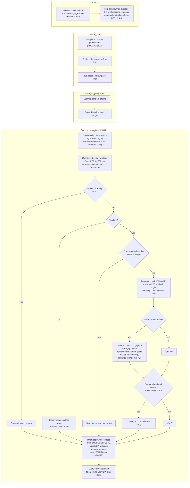
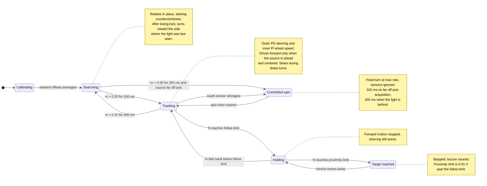

# Mobile Quad-Direction Light-Tracking Robot (TI C2000)

Differential-drive robot that locates a light source and drives to it. A four-direction photodiode array feeds a cascaded controller (outer PD steering loop, inner PI wheel-speed loops) running in embedded C on a TI LAUNCHXL-F28379D. Built by a four-person team for UIUC ME 461, Computer Control of Mechanical Systems.

https://github.com/user-attachments/assets/d482ca25-0301-4277-831c-5e9ce1485547

Build log, photos and CAD files: [Hackster.io project page](https://www.hackster.io/541786/mobile-quad-direction-light-tracking-robot-41b3e4)

The main implementation is in [`final_project_alt.c`](final_project_alt.c), with the principal control logic in `SWI_isr()` and sensor/motor support distributed across the interrupt service routines and initialization functions.

## How it works

Four photodiode modules sit on a 3D-printed platform in a north, south, east, west layout, with north aligned to the direction of travel. Each module amplifies the photodiode current into a 0 to 3.3 V signal, which the LaunchPad ADC samples and scales to a 0 to 3 V range. The robot compares the four intensities, turns toward the brightest direction, drives forward once the source is ahead, and stops when it arrives.

<b>Firmware flowchart</b>

 

### Signal path

Three chained interrupts run the sensing and control, with the control loop executing every 4 ms (250 Hz).

| Interrupt | Role |
| --- | --- |
| `ADCA_ISR` | Samples the four photodiode channels (ADCA A2 to A5) and applies a 21st-order FIR low-pass filter. Coefficients were designed with MATLAB's `fir1` function. |
| `SPIB_isr` | Runs a startup calibration that averages ambient readings and subtracts them from live readings, reducing sensitivity to background light. |
| `SWI_isr` | Runs the outer light-tracking loop and inner wheel-speed loops, then writes the motor PWM commands. |

### Outer loop: light tracking (PD)

- **Directionality.** A light vector magnitude `m = sqrt((N - S)^2 + (W - E)^2)` measures how directional the light is. A low `m` means the light is similar in every direction, as with ambient lighting.
- **Normalized error.** The east-west difference is normalized, `(E - W) / (m + 0.25)`, so steering sensitivity stays consistent for dim, distant sources and bright, close ones. This keeps the robot responsive to weak sources without overreacting near strong ones.
- **PD control.** A PD controller converts the normalized error into a turn-rate command. The derivative term is smoothed with a first-order IIR filter to suppress sensor noise, and the gains are halved while driving forward to prevent swerving. A deadband and a turn-rate limit prevent small-error chatter and overshoot.
- **Diagonal compensation.** When the source sits at 45 degrees between two sensors (north and east, or north and west), the east-west error can fall inside the deadband even though the direction is clear. The controller detects this case and biases the error so the robot still turns toward the source.
- **Rear source.** If the south sensor reads strongest, the robot commits to a fixed-direction spin, choosing the shorter way around based on the east and west readings.

### Inner loop: wheel speed (PI)

Wheel velocities are computed from quadrature encoder positions (eQEP1 and eQEP2). A coupled PI controller compares the commanded forward speed and turn rate with the measured wheel speeds and outputs left and right motor efforts, which are saturated and mapped to ePWM duty cycles. Anti-windup clamping limits integral accumulation, and the integrators reset whenever the robot is stopped.

### Behavior states

| State | Behavior |
| --- | --- |
| Searching | Rotates slowly in place to scan for a directional source. The search starts counterclockwise, and if the robot sweeps past a source, it reverses toward the side where the light was last seen. An earlier fixed counterclockwise search kept rotating past the source, so this reversal lets the robot settle onto it instead. |
| Tracking | Entered once a strong source (`m` above the start threshold) persists for 200 ms. Steers with the outer PD loop and drives forward only when the source is ahead and roughly centered. Forward speed drops during sharp turns. |
| Committed spin | Short fixed-direction turn, used when the source is acquired far off-axis or detected behind the robot. Sensor changes are ignored until the spin completes, preventing back-and-forth wiggle. |
| Target reached | A first front-sensor threshold stops forward motion. A second threshold, 0.01 V beyond it, sounds the buzzer to signal a strong source directly ahead. |

Tracking and searching use separate start and stop thresholds (hysteresis). If no directional source is detected for 400 ms, the robot returns to searching.

The main implementation is in [`final_project_alt.c`](final_project_alt.c), with the principal control logic in `SWI_isr()` and sensor/motor support distributed across the interrupt service routines and initialization functions.

## Hardware

| Item | Qty |
| --- | --- |
| Photodiode module (amplified analog output) | 4 |
| TI LAUNCHXL-F28379D C2000 Delfino LaunchPad | 1 |
| Custom PCB | 1 |
| DC drive motors with quadrature encoders | 2 |
| 3D-printed sensor platform and photosensor cover | 1 set |

The sensor cover reduces glare from the modules' onboard LEDs and light bleed from off-axis sources. STEP files are on the Hackster page.

### Peripheral map

| Subsystem | Peripheral | Purpose |
| --- | --- | --- |
| Photodiode array | ADCA A2 to A5 | West, east, south and north light readings |
| Drive motors | ePWM2A, ePWM2B | Right and left motor commands |
| Wheel encoders | eQEP1, eQEP2 | Wheel position and velocity feedback |
| Buzzer | ePWM9A (GPIO16) | Target-reached signal |
| Debug output | SCIA | Serial diagnostics |
| LabVIEW link | SCID | Live telemetry during testing |

## Software and tools

- **Code Composer Studio:** firmware build, flash and debugging
- **MATLAB:** FIR filter coefficient design
- **LabVIEW Community Edition:** live monitoring of sensor readings and robot parameters during testing

## Repository layout

| Path | Contents |
| --- | --- |
| `final_project_alt.c` | Robot application: peripheral setup, interrupt service routines, filtering, calibration, state machine and control loops |
| `F2837xD_*.c`, `*.asm` | TI device support files (original license headers retained) |
| `F28379dSerial.c/.h`, `F28379dCAN.c/.h`, `LEDPatterns.c/.h`, `buffer.h`, `song.h` | ME 461 course support libraries |
| `device/` | Device headers and driver library files |
| `targetConfigs/` | Code Composer Studio target configuration |
| `*.cmd` | Linker command files for RAM and flash builds |
| `.project`, `.cproject`, `.ccsproject` | Code Composer Studio project metadata |

The firmware was built on top of the course lab framework, so `final_project_alt.c` still initializes some peripherals that the light tracker does not use. These include the SPI IMU with Kalman tilt estimation and a CAN bus receiving distance data from external range sensors for an earlier wall-following lab. Neither feeds the tracking or motor control.

## Build and run

1. Install Code Composer Studio with C2000 device support.
2. Clone this repository and import it with **File > Import > CCS Projects**.
3. Select the RAM linker file (`2837xD_RAM_lnk_cpu1.cmd`) for debugging or the flash linker file (`2837xD_FLASH_lnk_cpu1.cmd`) for standalone operation.
4. Build and load the program to CPU1 of the LaunchPad.
5. Keep the robot stationary under stable ambient light until calibration finishes (the blue LaunchPad LED indicates calibration), then introduce the light source.

For first runs after any gain or wiring change, lift the wheels off the ground and confirm motor direction and encoder sign before testing on the floor.

<b>Tuning parameters</b>

All parameters are declared near the top of `final_project_alt.c`.

| Parameter | Role |
| --- | --- |
| `Kp_light`, `Kd_light` | Outer loop proportional and derivative gains |
| `Ki_light` | Outer loop integral gain. Held at 0 because photodiode error accumulates and causes windup and overshoot. Left in place for future tuning. |
| `alpha` | Smoothing coefficient for the derivative IIR filter |
| `deadband` | Normalized error band treated as centered |
| `max_turn_rate` | Turn-rate command limit |
| `m_tracklimit_start`, `m_tracklimit_stop` | Hysteresis thresholds for entering and leaving tracking |
| `front_sensor_follow_limit` | Front-sensor limit for forward travel |
| `front_sensor_prox_limit` | Front-sensor limit for stopping and sounding the buzzer |
| `Kp`, `Ki` | Inner wheel-speed PI gains |
| `Kp_turn` | Coupling gain for differential turning |

Tune one loop at a time. Verify sensor polarity and encoder direction first, then the wheel-speed loops, then the light-tracking loop at low speed.

<b>Telemetry</b>

SCIA prints the north, east, west and south sensor values, forward-motion flag, spin command and turn strength for serial debugging. SCID streams light directionality, sensor values and normalized steering error to a LabVIEW front panel, which can also send forward-speed and turn commands back to the robot during testing.

## Future work

- **Eight-direction sensor array.** Add NE, NW, SE and SW photodiodes to improve angular resolution, remove the dead zones between cardinal sensors and smooth steering when the source is off axis.
- **Tilt axis.** Add a servo-driven tilt mechanism so the robot can find the elevation of peak intensity and track sources that are not in its horizontal plane.

## Team

ME 461 Team 12, University of Illinois Urbana-Champaign.

| Member | Contributions |
| --- | --- |
| Yun Hui (Ryan) Phoon ([GitHub](https://github.com/ryanpyh), [Hackster](https://www.hackster.io/yphoon2)) | Photosensor cover CAD, photodiode calibration and testing, light-tracking logic refinement, control code tuning |
| Harry Hu ([Hackster](https://www.hackster.io/harry-hu)) | Photodiode calibration and testing, light-tracking logic refinement, control code tuning |
| William Wu ([Hackster](https://www.hackster.io/william-wu)) | Photodiode calibration and testing, ADC sequence code, light-tracking algorithm |
| Christina Li ([Hackster](https://www.hackster.io/zl118)) | Photosensor platform CAD |

## License

Released under GPL-3.0, matching the Hackster project. TI device support files and ME 461 course libraries retain their original licenses and headers.
